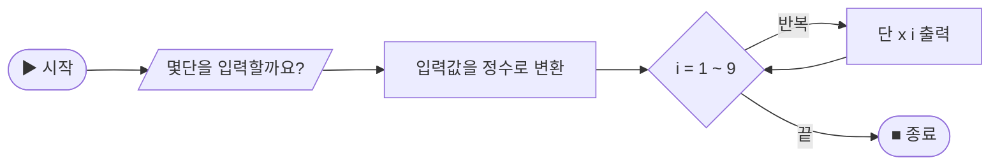
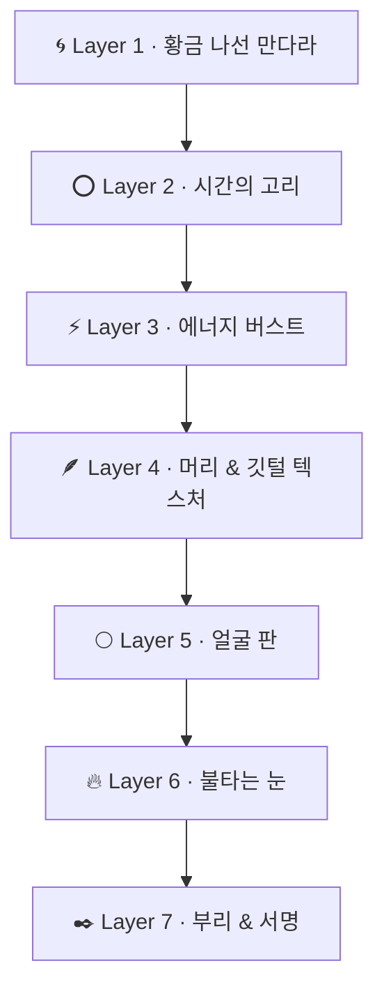

<!-- ═══════════════════════ HEADER ═══════════════════════ -->
<div align="center">


<br/>


</div>

<br/>

> ### 🦉 *"부엉이는 밤에 눈을 뜬다. 모두가 잠든 시간에도, 보는 자는 멈추지 않는다."*

<br/>

---

## 🌌 오늘의 다짐

<div align="center">

# 今 我 異 昨 我

### 금 아 이 작 아

**오늘의 나는, 어제의 나와 다르다.**

</div>

> 한 줄의 코드, 한 번의 커밋, 하나의 잔디.
> 그것들이 쌓여 어제와 다른 오늘의 나를 만든다.

---

## 📂 Repository Structure

```
📦 dreams-and-hopes
 ┣ 📜 gugudan.py        ← 입력 기반 구구단 함수
 ┣ 📜 turtle_owl.py     ← 터틀 그래픽 아트: THE WATCHER
 ┣ 🖼️ owl.png           ← 실행 결과 스크린샷
 ┗ 📘 README.md         ← 지금 보고 있는 이 문서
```

| 파일 | 역할 | 핵심 개념 |
|:---:|:---|:---|
| `gugudan.py` | 단을 입력받아 구구단 출력 | `def` · `input` · `for` · `range` |
| `turtle_owl.py` | 터틀로 그린 부엉이 작품 | 레이어 구조 · 그라데이션 · 방사형 패턴 |

---

## 1️⃣ MODULE 01 — 구구단 함수

<details open>
<summary><b>⚙️ 동작 흐름 보기</b></summary>

<br/>



</details>

### 💻 실행 예시

```
몇단을 입력할까요? 7
7 x 1 = 7
7 x 2 = 14
7 x 3 = 21
7 x 4 = 28
7 x 5 = 35
7 x 6 = 42
7 x 7 = 49
7 x 8 = 56
7 x 9 = 63
```

---

## 2️⃣ MODULE 02 — THE WATCHER 🦉

<div align="center">


*눈을 감지 않는 자. 시간의 고리 한가운데에서 모든 것을 바라본다.*

</div>

### 🎨 레이어 아키텍처

그림은 **뒤에서 앞으로**, 총 7개의 레이어를 쌓아서 완성된다.



### 🔬 Technique Breakdown

| 기법 | 설명 |
|:---|:---|
| 🌀 **Spiral Mandala** | 120°에서 1°를 비튼 119° 회전을 260번 반복해서 회전하는 소용돌이를 만든다 |
| 🎨 **Color Interpolation** | 두 RGB 색을 비율로 섞는 함수로 보라색에서 주황색으로 부드럽게 이어지는 그라데이션을 표현한다 |
| 🪶 **Procedural Feathers** | 무작위 각도와 길이의 짧은 획 1,400개 이상으로 깃털 질감을 생성한다 |
| 👁️ **Iris Mechanics** | 동심원 그라데이션에 방사형 선을 겹쳐서 기계식 조리개 같은 홍채를 만든다 |
| ⚡ **Render Optimization** | `tracer(0)`로 그리는 과정을 숨기고 `update()`로 한 번에 출력해서 속도를 끌어올린다 |

---

## 🚀 How to Run

```bash
# 1. 저장소 복제
git clone https://github.com/아이디/저장소이름.git

# 2. 구구단 실행
python gugudan.py

# 3. 부엉이 소환
python turtle_owl.py
```

> ⚠️ 터틀 그래픽은 창을 띄워야 하기 때문에 Colab 같은 웹 환경이 아니라 **내 컴퓨터의 파이썬**으로 실행해야 한다.

---

## 👤 Author

<div align="center">

| | |
|:---:|:---|
| **이름** | 김성훈 |
| **전공** | 🎮 게임콘텐츠 |
| **좌우명** | 今我異昨我 |

<br/>

*"오늘 심은 잔디 한 칸이 내일의 숲이 된다."* 🌱

</div>

<!-- ═══════════════════════ FOOTER ═══════════════════════ -->

