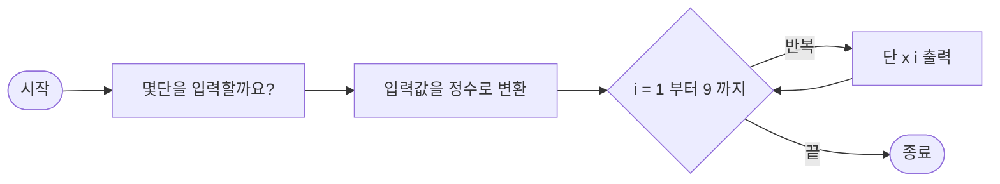

<div align="center">

# 🐍 Python Practice


파이썬으로 만든 구구단 함수와 터틀 그래픽 작품

</div>

---

## 오늘의 다짐

<div align="center">

### 今我異昨我 (금아이작아)

오늘의 나는 어제의 나와 다르다.

</div>

---

## 📂 파일 구성

| 파일 | 설명 | 사용한 개념 |
|:---:|:---|:---|
| `gugudan.py` | 단을 입력받아 구구단 출력 | `def` · `input` · `for` · `range` |
| `turtle_owl.py` | 터틀로 그린 부엉이 | 레이어 구조 · 그라데이션 · 방사형 패턴 |
| `image.png` | 부엉이 실행 결과 스크린샷 | |

---

## 1️⃣ 구구단

몇 단을 입력할지 물어본 다음, 그 단의 구구단을 출력합니다.



### 실행 예시

```
몇단을 입력할까요? 7
7 x 1 = 7
7 x 2 = 14
7 x 3 = 21
7 x 4 = 28
7 x 5 = 35
7 x 6 = 42
7 x 7 = 49
7 x 8 = 56
7 x 9 = 63
```

---

## 2️⃣ 터틀 그래픽 - 부엉이

<div align="center">

</div>


> 터틀은 창을 띄워야 해서 Colab 같은 웹 환경이 아니라 내 컴퓨터의 파이썬으로 실행해야 합니다.

---

## 👤 만든 사람

| 이름 | 전공 |
|:---:|:---:|
| 김성훈 | 게임콘텐츠 |
