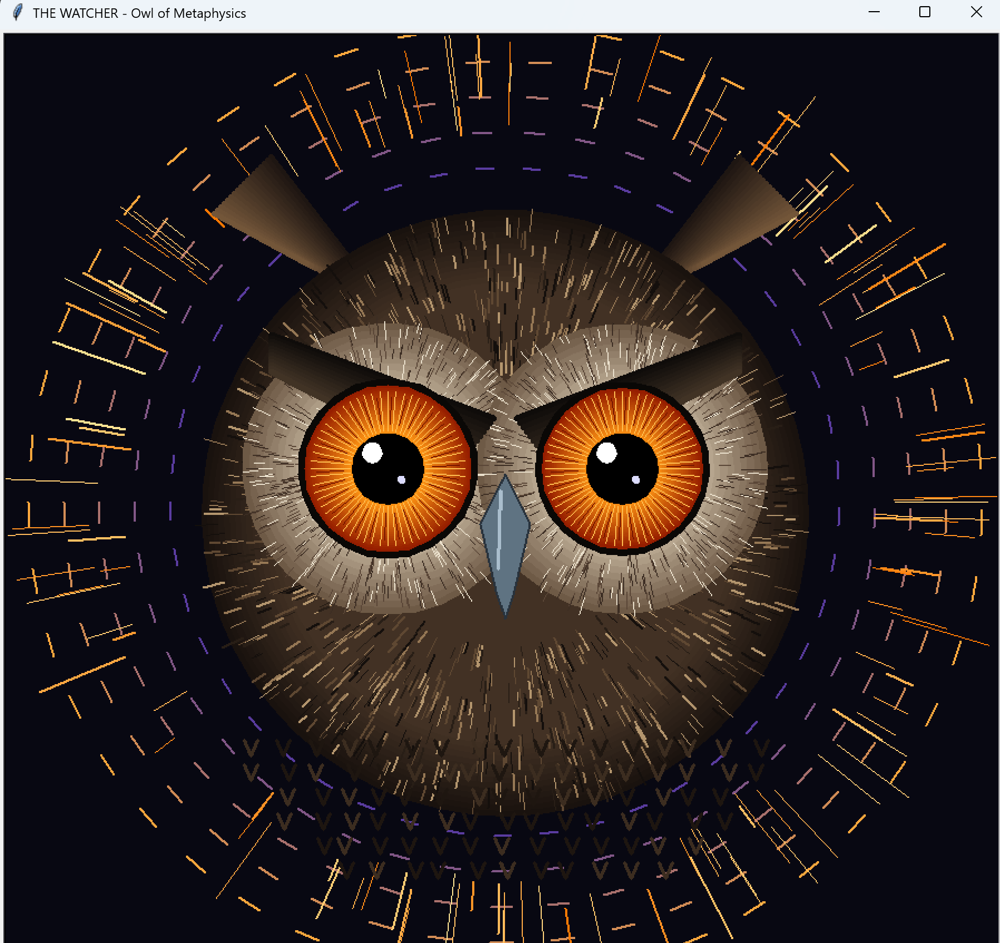

# 🦉 꿈과 희망이 가득한 Python Repository

> 파이썬으로 만든 구구단 계산기와 터틀 그래픽 작품


---

## 📂 파일 구성

| 파일 | 설명 |
|------|------|
| `gugudan.py` | 단을 입력받아 구구단을 출력하는 함수 |
| `turtle_owl.py` | 터틀로 그린 부엉이 작품 |

---

## 1️⃣ 구구단

몇 단을 입력할지 물어본 다음, 그 단의 구구단을 출력합니다.

```
몇단을 입력할까요? 7
7 x 1 = 7
7 x 2 = 14
...
7 x 9 = 63
```

---

## 2️⃣ 터틀 작품 - THE WATCHER



- 황금 나선 만다라 배경
- 그라데이션으로 표현한 불타는 눈
- 방사형 깃털 텍스처

---

## 🚀 실행 방법

```bash
python gugudan.py
python turtle_owl.py
```

---

## 👤 Author
- 김성훈
